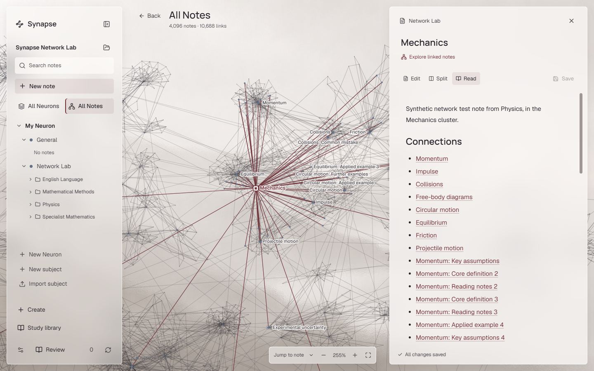

# Synapse

A Windows workspace for Markdown notes, linked knowledge, flashcards, quizzes and reminders. Explore your notes in a frosted-glass 2D graph, revise locally, and optionally create editable study drafts with AI.



## Install

Download the Windows x64 installer and SHA-256 checksum from [Releases](https://github.com/nottbradd/Synapse/releases). Verify the download in PowerShell with `Get-FileHash .\Synapse_0.6.0_x64-setup.exe -Algorithm SHA256`, then run the installer.

**The installer is unsigned.** Windows may identify its publisher as unknown. Download only from this repository and compare the checksum before deciding whether to install. No administrator access is normally required for the per-user installation.

Targets Windows 10 22H2 and Windows 11, x64, with Microsoft Edge WebView2 Runtime. The current release is verified on Windows 11; Windows 10 has not received a separate hardware test. The installer can obtain WebView2 if missing, which requires internet access. There are no macOS, Linux or ARM installers in this release.

Open a folder of Markdown notes to start. Synapse does not populate your vault with sample content. For a demonstration, copy `fixtures/demo-vault` to a temporary folder.

## Explore and study

- **Overview → subject subnetwork → topic → linked concepts.** Subject junctions use actual membership; a topic expands its real WikiLinks, including links across subjects. Each view is one hop, so cyclic links never create nested copies. Expanding a graph never calls AI.
- **Back** restores the previous scope, selected note, camera and layout. The overview control returns to the starting network. Closing a note keeps the current network. Graph exploration does not reassign notes or change the review scope selected in the sidebar.
- Use search, hover, wheel zoom or **Browse** to reach notes in dense networks. Neurons contain subjects, and identically named subjects in different Neurons remain distinct.
- Edit Markdown with WikiLink completion, math and explicit saves. Unsaved-edit and disk-conflict guards protect navigation. Review flashcards, take saved quizzes and manage reminders offline.
- **Preferences** provides persistent Sound, Volume, and Follow Windows / Full / Reduced animation settings. Original related chimes distinguish warm subnetworks, clear topics and lighter linked concepts. Reduced mode keeps navigation and relationships without spatial travel or moving currents. Typing and hover stay silent.

## Storage and privacy

Markdown stays in the folder you open. Organization and study metadata live under the vault's `.synapse` directory; review schedules live in `flashcards.json`. Existing note paths, identities and WikiLink semantics are preserved. Portable subject imports/exports retain explicit history choices; imported reminders start paused. See [vault compatibility](MIGRATION.md).

Device settings and the last vault location live under `%APPDATA%\com.synapse.study`. Sound/motion preferences live in WebView2 local storage. Credentials are stored separately in Windows Credential Manager and are not included in vault exports. Core editing, graph navigation, saved study and local reminder scheduling need no account or network service.

AI is optional and requires an explicit generation action:

| Mode             | Connection and access                                                                                                                                                                                                       |
| ---------------- | --------------------------------------------------------------------------------------------------------------------------------------------------------------------------------------------------------------------------- |
| Personal API key | Your key calls OpenAI directly from Rust. API billing is separate from a ChatGPT subscription.                                                                                                                              |
| Synapse AI       | A private invitation and explicit content-transfer consent are required. Requests pass through the Synapse Cloudflare gateway to OpenAI; the owner's service key stays on the server. Public downloads do not grant access. |

The source preview identifies the selected content before generation. Quiz/card requests send selected note bodies, titles, identifiers and your instructions; reminder requests use titles/references and scheduling context. Generated output remains an editable, unsaved draft until you explicitly save it. Check its accuracy. The gateway stores authentication and usage/accounting metadata; provider handling remains subject to OpenAI's policies. No automatic switch to personal billing occurs when hosted AI is unavailable.

The current hosted pilot is limited to **5 people**, **10 generations/person/UTC day**, **3 submissions/person/minute**, and **one active generation/person**. Shared spending admission is bounded by **US$5/day, US$60/month and US$60 cumulative**. Service ends no later than **25 November 2026 at 11 am Australia/Sydney (00:00 UTC)**; there is no automatic funding renewal. Earlier quota, funding, credential or availability limits can stop generation. Saved local features continue working. [Owner service guide](backend/ai/README.md).

Reminders need the installed app process and Windows notifications. **Keep reminders running when the window closes** leaves Synapse in the tray; **Quit** stops delivery until the next launch. Sign-in startup is optional. Missed reminders appear as catch-up entries. The app does not install an OS service that delivers after full exit.

## Develop

Install Node.js 24 LTS or newer, stable Rust (MSVC x64), Visual Studio 2022 Build Tools with Desktop development with C++, Windows SDK, and WebView2. See [Tauri prerequisites](https://v2.tauri.app/start/prerequisites/).

```powershell
npm ci
npm ci --prefix backend/ai
npm run tauri dev

# Public origin only; no service credential belongs in a desktop build.
$env:SYNAPSE_AI_URL = 'https://synapse-ai.nottbradd.workers.dev'
npm run tauri build
```

Without that optional build variable, hosted AI reports that it is not configured. The executable is under `src-tauri/target/release`; the NSIS installer is under `src-tauri/target/release/bundle/nsis`. `npm run dev` alone serves the UI without native vault access. Each release includes [source archives and rebuilding instructions](docs/SOURCE.md), matching source tags, lockfiles and build scripts.

```powershell
npm run typecheck
npm run lint
npm test
npm test --prefix backend/ai
npm run build
cargo fmt --manifest-path src-tauri/Cargo.toml --check
cargo test --locked --manifest-path src-tauri/Cargo.toml
cargo clippy --locked --manifest-path src-tauri/Cargo.toml --all-targets -- -D warnings
```

Gateway tests use a local database and mocked provider, never owner-funded inference. [Validation](VALIDATION.md), [interaction architecture](INTERACTION.md), [detailed user guide](docs/USER_GUIDE.md), and [asset provenance](docs/ASSETS.md).

## License

Copyright © 2026 nottbradd and contributors. Synapse is licensed under **GNU GPL version 3 only (GPL-3.0-only)**, without warranty; see [LICENSE](LICENSE) and [NOTICE](NOTICE). Distributed modified versions must comply with that license, including its corresponding-source requirements. Third-party components retain their own licenses, listed in `THIRD_PARTY_NOTICES.txt` and `public/licenses`. The code license does not provide hosted AI access, credits, credentials or a service guarantee.
